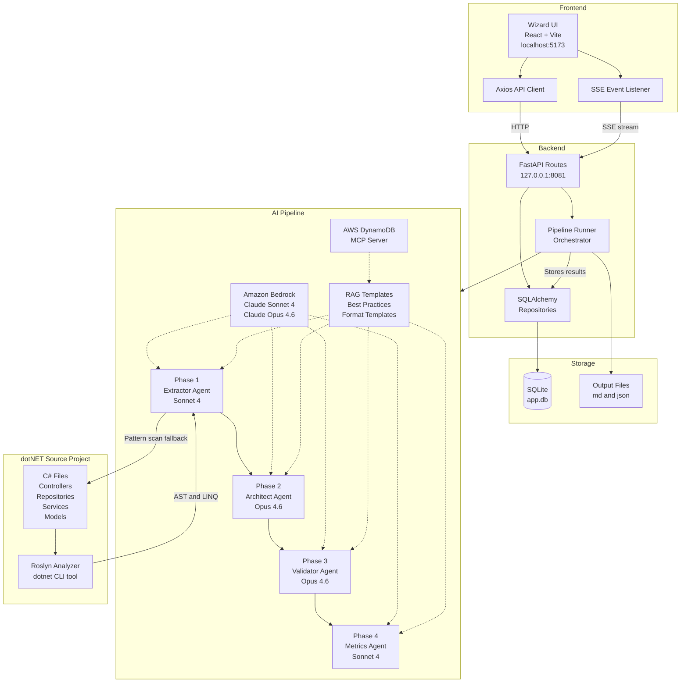
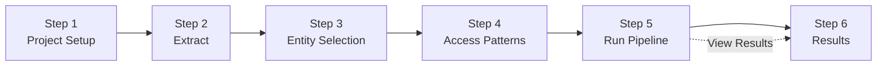
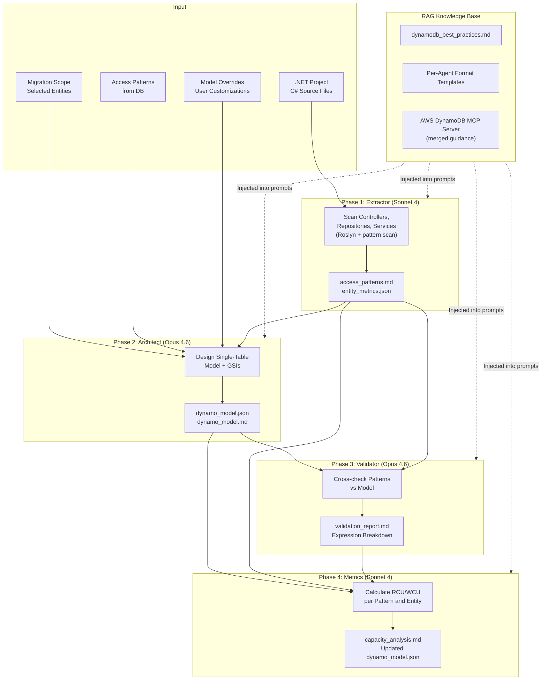
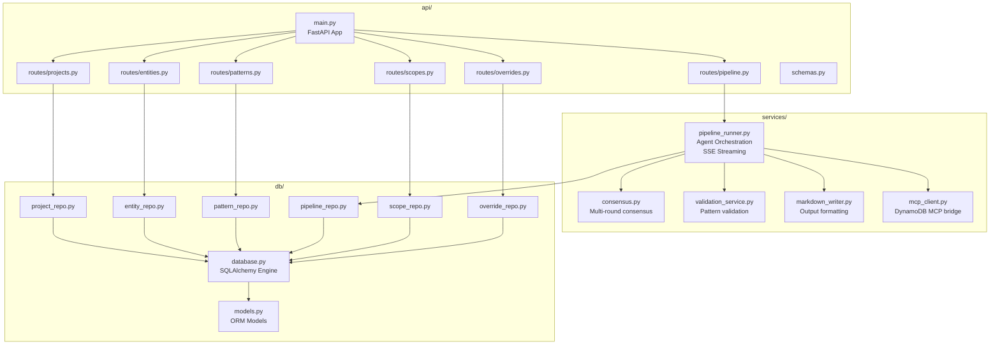
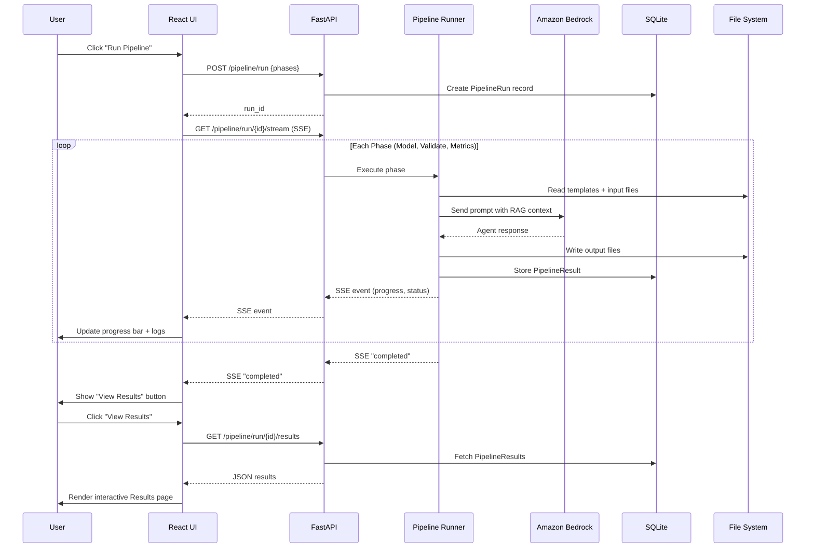

# SQL to DynamoDB Design Mentor — Architecture

## High-Level Architecture

## UI Wizard Flow

| Step | Page | What the user does |
|------|------|--------------------|
| 1 | Project Setup | 📂 Set name, .NET project path, AWS profile |
| 2 | Extract | 🔍 Scan the .NET codebase |
| 3 | Entity Selection | 🏗️ Toggle entities in scope for the migration |
| 4 | Access Patterns | 📊 Review and edit the extracted access patterns |
| 5 | Run Pipeline | 🚀 Execute the four-agent pipeline |
| 6 | Results | 📋 Interactive model view, validation, capacity |

## AI Pipeline Detail

## Backend Module Structure

## Data Flow: Pipeline Execution

## Entry Points

The repository has two operational entry points:

- **React UI + FastAPI backend (primary)** — Frontend at `frontend/` served by Vite on `5173`, FastAPI backend at `backend/api/main.py` on `127.0.0.1:8081`. This is the supported six-step wizard described above.
- **Streamlit app (`app.py`, legacy)** — A single-process Streamlit alternative that reuses the same `pipeline.py` agents directly. Useful for quick local trials without running the full backend, but it does not use SQLite persistence, the SSE pipeline runner, or the per-project overrides supported by the React UI.
